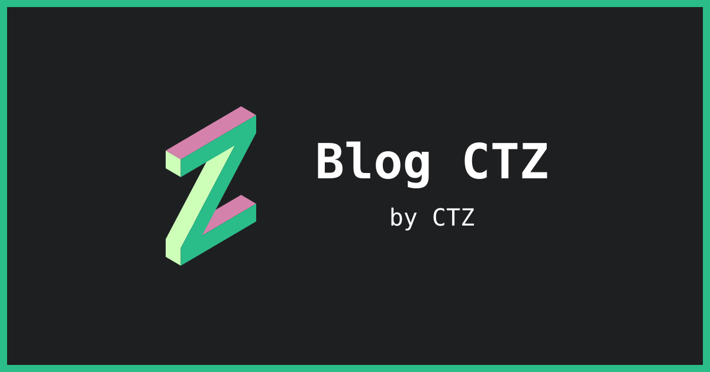

# Blog CTZ

**Blog CTZ - 沙楚子的新新新新博客**



## 关于

我是沙楚子，一个研究型设计师，喜欢思考和探索些不一样的东西。这里记录创作、工具实践与日常思考，包含文章（Posts）、短记（Notes）和标签（Tags）。

本站基于 [Astro Cactus](https://github.com/chrismwilliams/astro-theme-cactus) 构建，使用 Astro、Tailwind CSS 与 Markdown/MDX，支持明暗主题、Pagefind 搜索、RSS 和中文分享图。

博客已上线，可访问 [Blog CTZ](https://chartreuse310.github.io/blog-ctz-v4/)。

## 本地运行

环境：Node **24.15.0**（`.nvmrc`）、pnpm **11.1.1**（`packageManager`）。

```sh
nvm use
pnpm install --frozen-lockfile
pnpm dev
```

打开 <http://localhost:4321/>。`pnpm dev` 会随内容修改自动更新；如果未加载 nvm，先按本机配置加载。

## 内容维护

| 类型 | 目录 | 用途 |
| --- | --- | --- |
| Posts | `content/posts/` | 完整文章，可为每篇建立目录并就近保存图片 |
| Notes | `content/notes/` | 简短记录 |
| Tags | `content/tags/` | 可选的标签页标题、简介与介绍正文 |

文章示例：`content/posts/my-post/index.md`

```yaml
---
title: "文章标题"
description: "一句话介绍这篇文章。"
publishDate: "2026-11-07T12:00:00+08:00"
tags: [obsidian]
draft: false
---
```

短记示例：`content/notes/my-note.md`

```yaml
---
title: "短记标题"
publishDate: "2026-11-07T12:00:00+08:00"
---
```

短记可选填 `description`。Notes 目前没有草稿过滤，未发布内容应放在集合目录外；文章可用 `draft: true`，生产构建会过滤草稿。

标签介绍示例：`content/tags/obsidian.md`

```yaml
---
title: "Obsidian"
description: "笔记与工具实践。"
---
```

在 frontmatter 后书写正文。文章填写 `tags` 后会自动生成标签页，只有需要自定义介绍时才建立标签文件；文件名须与标签值匹配。标签会去除首尾空格、转小写并去重。

图片使用标准 Markdown，例如 ``。无需重复正文一级标题，页面会使用 frontmatter 的标题。

文章未设置 `ogImage` 时，自动使用思源黑体生成分享图；设置 `ogImage: "/social-card.png"` 则使用默认分享图。

## 配置与部署

| 配置内容 | 入口 |
| --- | --- |
| 站名、作者、简介、语言、日期与菜单 | `src/site.config.ts` |
| 首页、关于页和社交链接 | `src/pages/index.astro`、`src/pages/about.astro`、`src/components/SocialList.astro` |
| 正文样式 | `src/layouts/Base.astro`、`src/styles/global.css` |
| 内容字段校验 | `src/content.config.ts` |
| 标志与默认分享图 | `public/icon.svg`、`public/social-card.svg`、`public/social-card.png` |
| 自动分享图排版与字体 | `src/pages/og-image/`、`src/assets/fonts/source-han-sans/` |

支持根目录与 GitHub Pages 项目子目录，通过构建环境变量配置：

```sh
# 复现当前 GitHub Pages 的生产构建
SITE_URL=https://chartreuse310.github.io SITE_BASE=/blog-ctz-v4/ pnpm build

# 根目录／自定义域名示例
SITE_URL=https://example.com SITE_BASE=/ pnpm build
```

`SITE_URL` 填根域名，`SITE_BASE` 填路径。未指定时沿用本地地址和 `/`；发布目录为 `dist/`，无需额外套一层仓库名目录。推送到 `main` 后，[GitHub Actions 工作流](.github/workflows/ci.yml) 会运行测试、构建并校验产物路径，通过后将 `dist/` 发布到 GitHub Pages。部署进度可在 [Actions](https://github.com/Chartreuse310/blog-ctz-v4/actions) 查看。

更多路径说明、常见问题见 [维护指南](docs/maintenance.md)。

## 检查与维护

```sh
pnpm test
pnpm check
pnpm build
pnpm preview
```

开发与生产预览均使用 4321 端口，切换前先停止正在运行的服务器。生产预览只展示上次构建结果，搜索也应在生产预览验证。

构建后可检查站内引用是否匹配部署路径：

```sh
# 参数与刚才的构建配置保持一致
python scripts/check-deployment.py /blog-ctz-v4/ https://chartreuse310.github.io
```

`pnpm lint` 和 `pnpm format` 会改写文件；只读检查使用 `pnpm check`。故障处理与上游更新方式见 [维护指南](docs/maintenance.md)，历史验证记录见 [setup-verification.md](docs/setup-verification.md)。

## 许可与转载

- **代码与开发文档**：采用 [MIT License](LICENSE)，保留 Astro Cactus 原作者及本项目的版权声明；第三方另有许可的部分除外。
- **原创文章、短记与标签介绍文字**：除另有说明外，采用 [CC BY-NC-ND 4.0](https://creativecommons.org/licenses/by-nc-nd/4.0/deed.zh-hans)。非商业转载须署名并附原文及许可链接；商业使用或传播演绎作品需另行许可。范围与细则见 [CONTENT-LICENSE.md](CONTENT-LICENSE.md)。
- **图片、截图、引用材料、第三方作品与站点标志**：不包含在上述原创文字许可范围内，按原有许可或单独说明处理。
- **思源黑体**：采用 [SIL Open Font License 1.1](src/assets/fonts/source-han-sans/LICENSE.txt)。

网站页脚的 `Copyright` 链接指向版权与转载说明。许可问题可通过 [GitHub](https://github.com/Chartreuse310) 联系 CTZ（沙楚子）。

## 致谢

- [Astro Cactus](https://github.com/chrismwilliams/astro-theme-cactus)：博客基础模板，作者 Chris Williams。
- [Astro](https://astro.build/)、[Tailwind CSS](https://tailwindcss.com/)、[Pagefind](https://pagefind.app/)：站点构建、样式与搜索。
- [Source Han Sans／思源黑体](https://github.com/adobe-fonts/source-han-sans)：中文分享图字体。
