> 不要让 AI 直出 UI，会不幸！
> ——沙楚子，2026年11月11日。

这次 GameJam 的主题是“碰撞”，要求“各种方式表现质感”，且“尽可能不出现文字”——最后这一项简直戳中 GPT 的死穴。别的 AI 我不知道，GPT-6.1 Sol 是真的喜欢在界面上写碎碎念。

## 1 迈出第一步就是走向胜利

正所谓“万事开头难”，AI 很好地帮我解决了开始时无从下手的困惑。在确定了大致的游戏方向后，我先让 GPT 帮我搜集了一波资料，包括界面和场景的风格参考。其实我一开始根本不知道应该找哪些内容，如果让我自己找，就是浏览一些相似题材的游戏，看看会不会产生灵感，再根据灵感进一步搜索。我把我粗略的想法告诉了 GPT，它帮我补充了一个很重要的部分——球在画面中的可视大小。这其实极为关键，但我并没有第一时间想到。

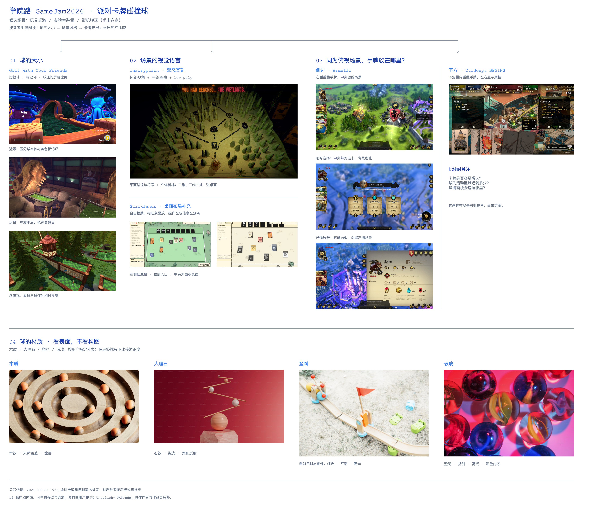

图1 最终整理的moodboard（我和GPT共同完善）

## 2 主视觉设计中的迷惘

我的界面设计始于策划发来的策划案、视觉元素表和手绘草稿。说实话，在翻完策划案和视觉元素表后，我的脑子里对于游戏长什么样还是很模糊，直到我看到策划的手绘草稿——

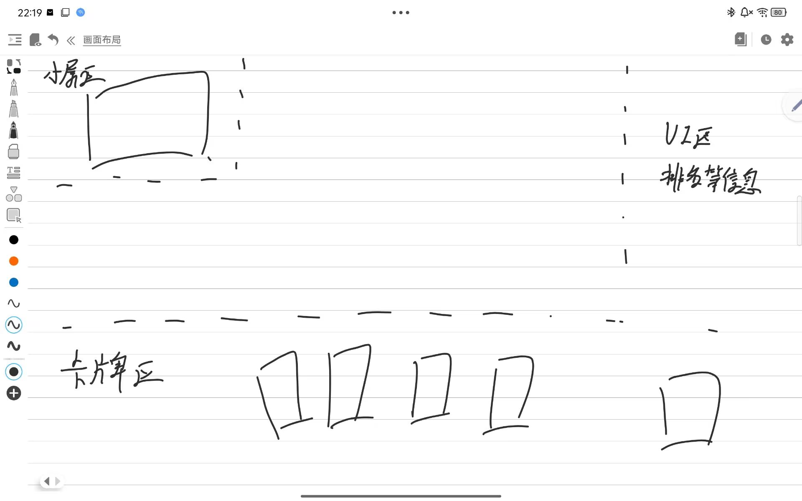

图2 界面布局示意（来自策划@三ling）

这个画技虽然不算很好，但是比动辄几千字的文字要容易理解多了。

其实我并不具备太多派对游戏的设计经验，尤其是高饱和度的配色——于是我让 GPT 先出个第0版。在我向 GPT 进行了详细的文字描述后，它给了我这个：

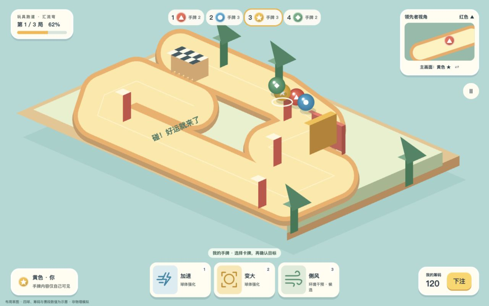

图3 GPT直出界面

朋友们，有人看到以后产生想玩的欲望了吗？

虽然有那么一瞬间，我觉得 AI 博主都是骗人的——但我也很快意识到问题所在：一，直接生成的 html 很难进行精细修改；二，不能让它直接用矢量图去画 3D 空间。于是我选择让 GPT 在 VectorCraft（一款开源的矢量图编辑软件）中生成界面以便我修改，而背景图则单独生成 3D 模型并以截图的方式嵌入主视图中。最终改成了以下这样：

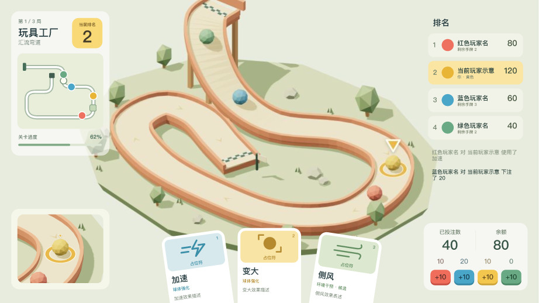

图4 修改后的主视觉设计

## 3 界面设计中的惊喜与惊吓

到了界面设计这一步，首先需要确认的是字体——从标题界面到每个界面的选项，虽然说要尽量少用文字，但还是不可避免地需要出现字体。以前我会到处寻找免费字体，但还是需要一一确认是否符合游戏的风格，这一步在 GPT 的帮助下变得异常容易。

因为找到的字体我很满意，就让 GPT 给我做了一个标题界面。

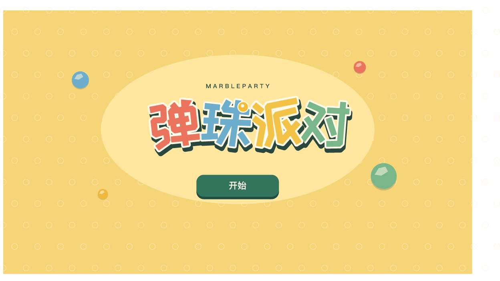

图5 GPT直出标题界面

……怎么说呢，虽然我很喜欢它把弹珠放到字体中的做法，但整体效果真的说不上好看。为了尽量简洁，我把没用的元素删掉，准备之后用一些游戏内场景放到标题后面的背景里充实画面。因此在右上角标注了小字——这回不怪GPT，这是我自己标的。

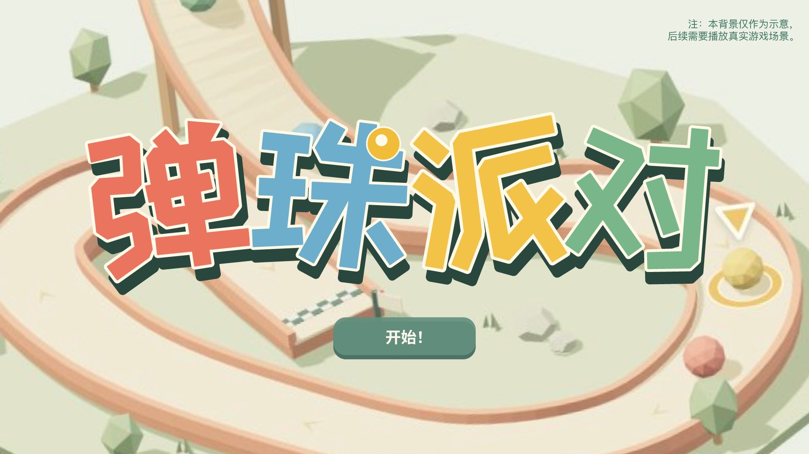

图6 在免费字体基础上做的标题初稿

不过到了具体界面里，我第一次遇到了不得不自己从头动手画的情况——也许是玩的游戏不够多，GPT 设计的游戏界面给人一种填表的感觉。说实话，这个布局从界面设计的角度来说其实是挺合理的，但是这种填表一样的体验与我想象中的派对游戏背道而驰。

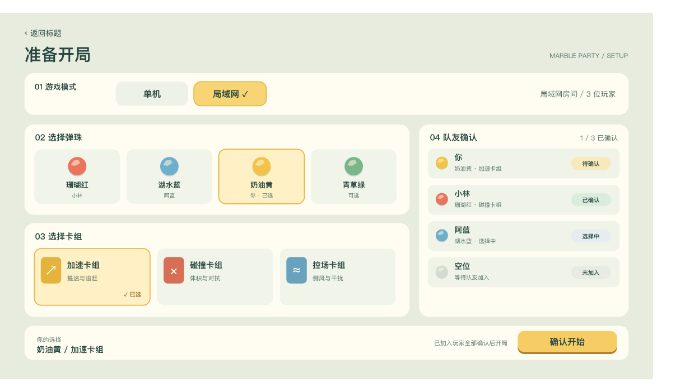

图7 GPT设计的游戏准备界面

之后我把想法告诉了它，比如一个界面专注选择一个内容，界面元素简单易懂——但无论我描述得多么具体，GPT 都无法按照画出符合我想象的界面。

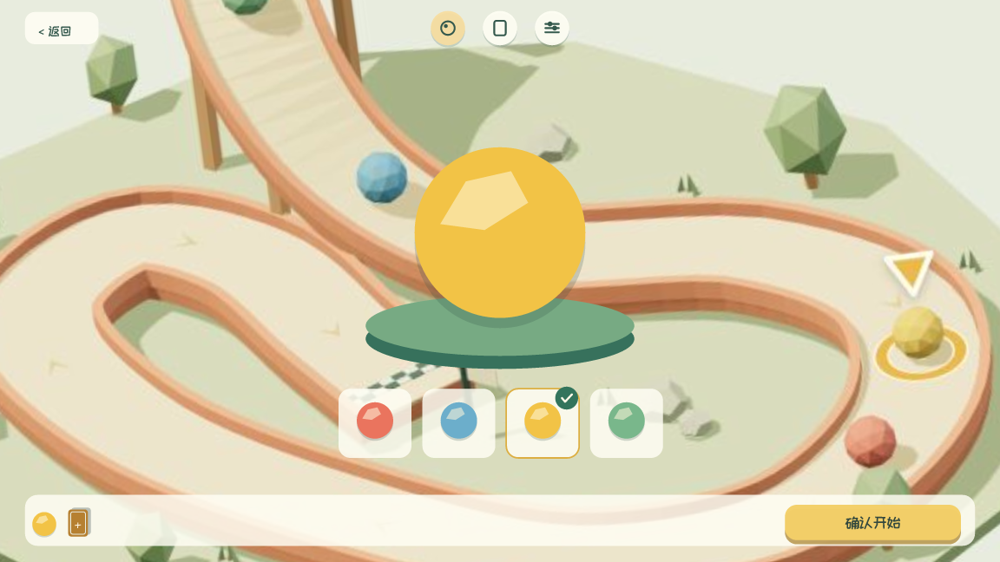

图8 GPT在我的要求下生成的界面一

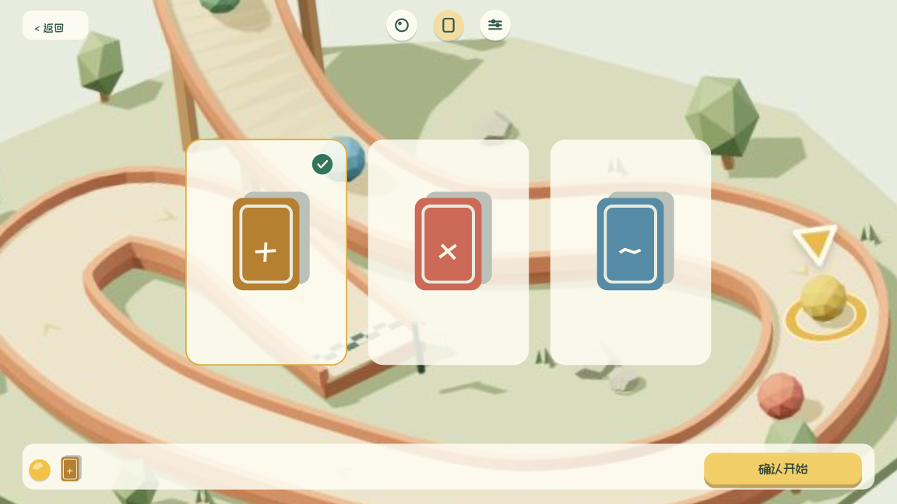

图9 GPT在我的要求下生成的界面二

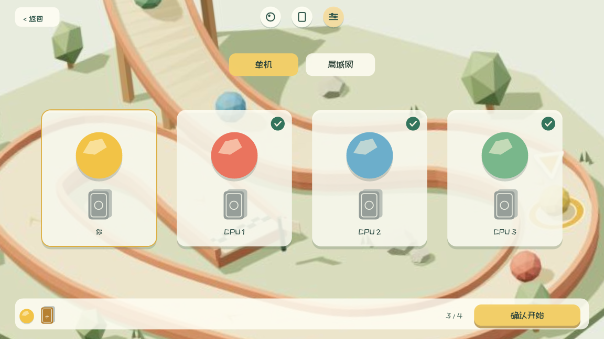

图10 GPT在我的要求下生成的界面三

这几个在我要求下修改的界面，根本没法用……

最终我选择把剪影设计好，让 GPT 帮我搭配不同的色彩，看看哪个效果比较好。其实稍微看一下就能发现，我的设计和 GPT 在我的要求下生成的界面整体思路是一样的，但 GPT 完全没有达到我想要的简洁。尤其是最近 AI 生成的界面见多了，我会主动避免线框式的选中效果。

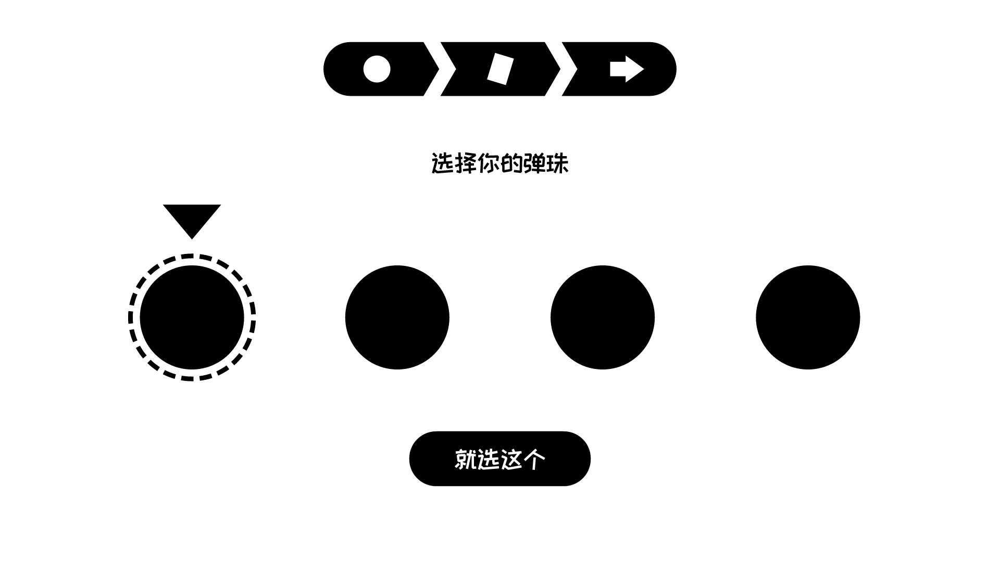

图11 我做的选择界面剪影一

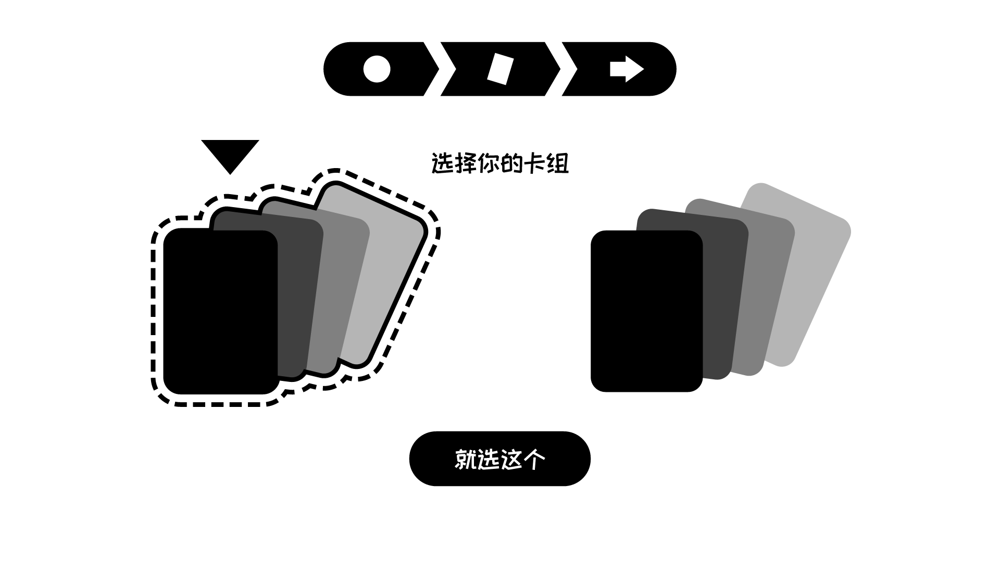

图12 我做的选择界面剪影二

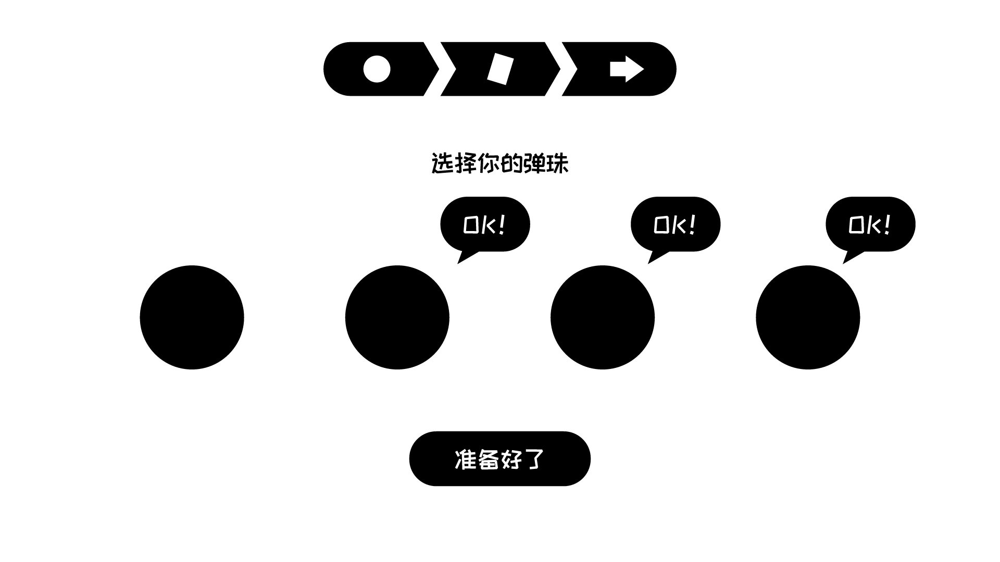

图13 我做的选择界面剪影三

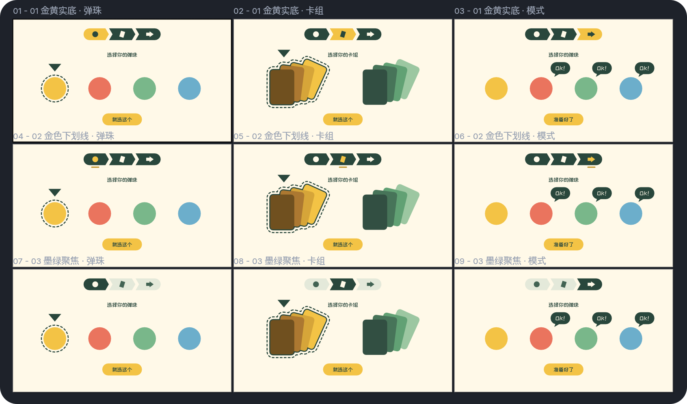

图14 GPT给我提供的三种配色方案

## 4 还有高手？？？

在完成了初步界面设计后，策划和程序开始着手开发游戏的实际功能，其中添加了一些我之前没有设计的界面——虽然我也不知道这是不是 GPT 生成的，但这些图确实是把 AI 喜欢在界面上写“小纸条”的习惯发挥到了极致。

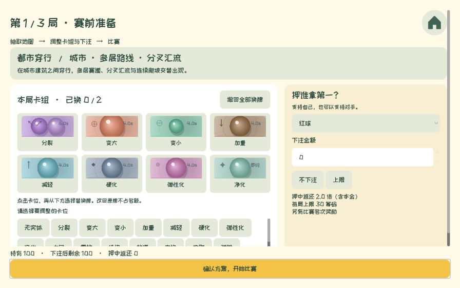

图15 开发初期的界面

说实话，看到这个界面的时候我真的眼前一黑……吓得我赶紧关上游戏，都忘了截图。

按照我以往的设计流程，往往都是先有框架图，再一步一步提高界面的完成度，因此很少在已经实装的界面上看到如此混乱的界面。在我静下心来梳理了界面需要的功能后，终于调整成了以下的样子。

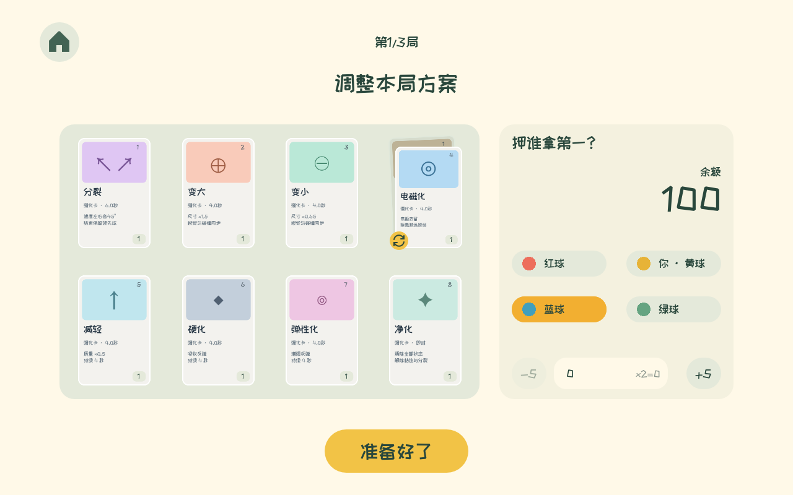

图16 调整后的界面

其实我觉得受到原始版本的影响，我也不自觉地在界面上多加了文字，比如右侧押注的部分也许不需要“你·黄球”这样的表达，完全可以靠视觉信息来显示，但我那时已经没有多余的脑子进一步去思考了。~~而且我刚刚忽然发现左上角的按钮没有和其他元素对齐，我好难受啊！~~

## 5 最后：我的发现

1. 坚决不要让 AI 直出 SVG 或 HTML，除非你只是想参考一下效果自己画。
2. 不要让 AI 使用矢量图去画 3D 空间，至少 GPT-6.1 Sol 不行。
3. 可以让 AI 帮忙汇总资料和参考，这比自己找得要快多了。
4. 可以用 VectorCraft 做好界面的剪影，让 AI 做几种不同的配色方案。
5. 别问我为什么没用 Astra 或者 Claude 的模型，我的碳基 token 还没有 Astra 值钱，我也不具备挑战封号的胆量。

图17 最离谱的一次结果，我已经看不出来这界面是想干嘛

其实到了最后，我好像应该感慨一下什么有了 AI 工作效率提高了，但 AI 也有它的弊端，可能影响设计思路但也可以怀着开放的心态辅助设计云云——但我不想。

正巧，前几天看到群友讨论到 GameJam 中使用 AI 的问题，甚至有人认为程序也应该禁止使用 AI，就让我以自己的一段思考结尾吧：

> 刚刚动漫社群里在讨论gamejam里让不让用AI。
> 由于我自己正在gamejam里大量用AI辅助设计，有一种别样的感受。我虽然自己做的时候觉得这真方便，既然我每一步只是让AI出初稿，我微调，或者我经过一大堆步骤一步步让AI的效果可以接受，我总觉得“这是可以接受的AI使用范围”。
> 然而冷静下来一想，其实我也知道从头开始手搓UI会更好看，但我只是为了更快完成任务，以及懒得学引擎的使用方法去自己调。这样一想，我忽然又觉得有必要配置好软件，看些教程，了解如何去手搓了——这并不是完全没意义的，比如我在Godot里现在就改不动AI的生成物了。
> 此外，我也别嘲笑程序员使用一眼AI的UI和美术，其实我也不知道真正好的代码应该是什么样的。可能我vibecoding出来的东西非常乱，对程序员来说看起来也非常恶心，只是我自己毫不在意而已。

那一刻，我突然觉得手搓什么都挺好玩的——比起使用 AI 时“心想事成”的感觉，手搓带来的掌控感是 AIGC 难以比拟的。
